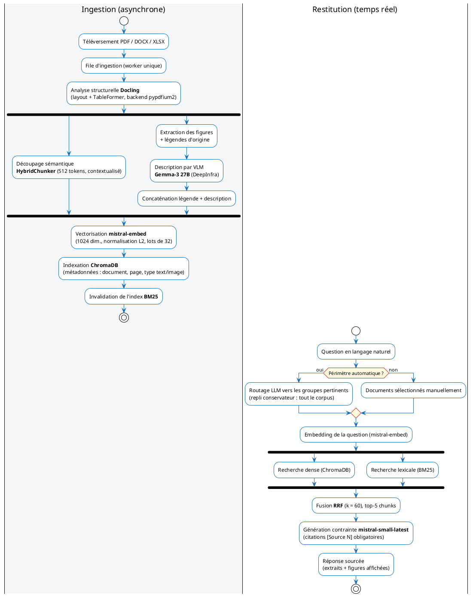
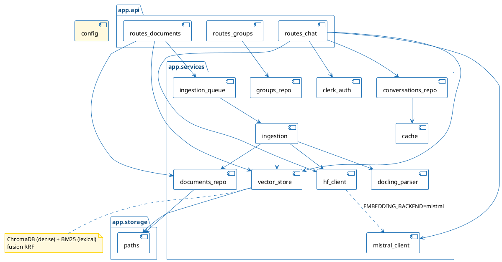
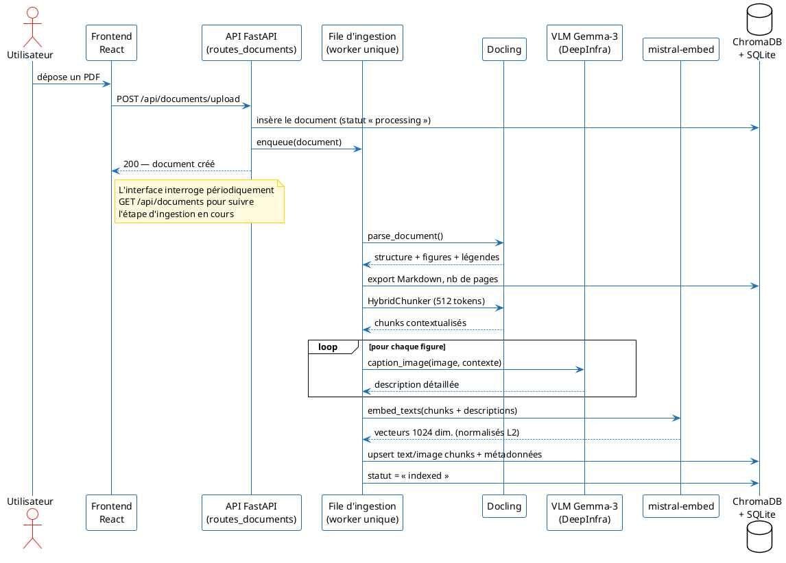
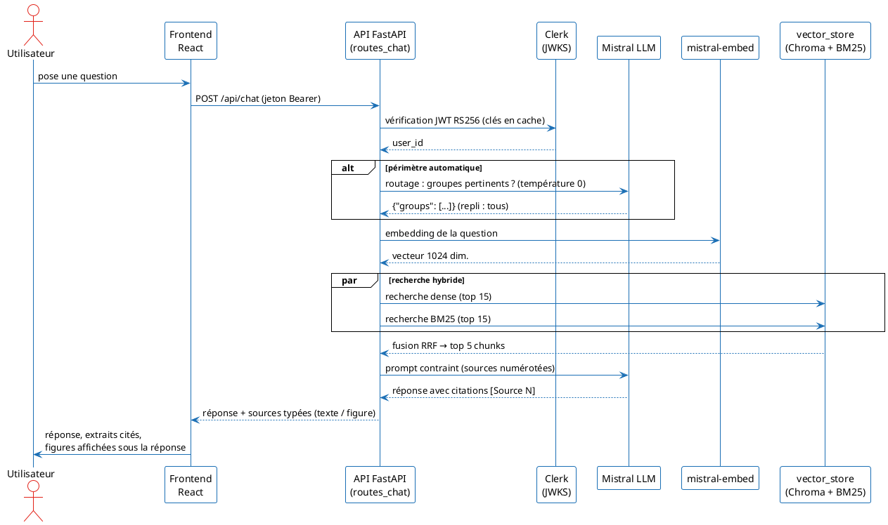
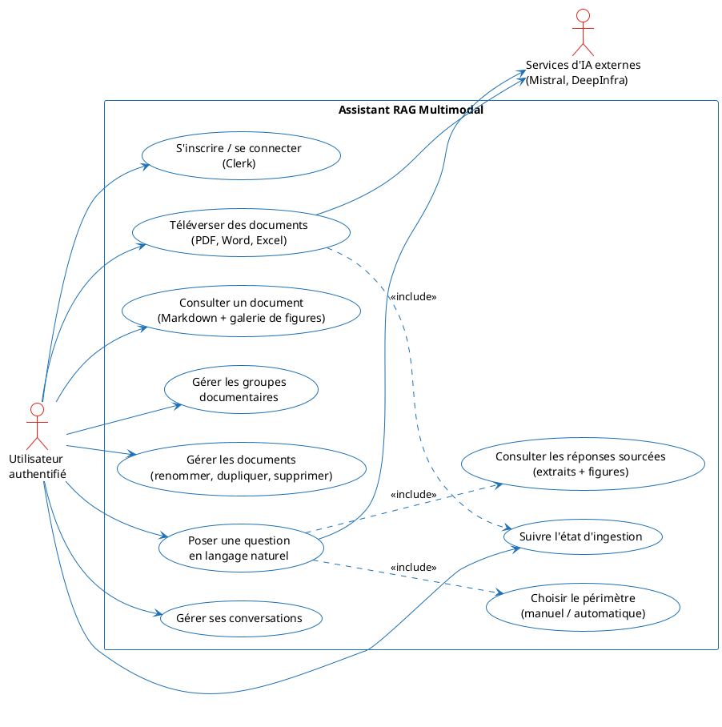
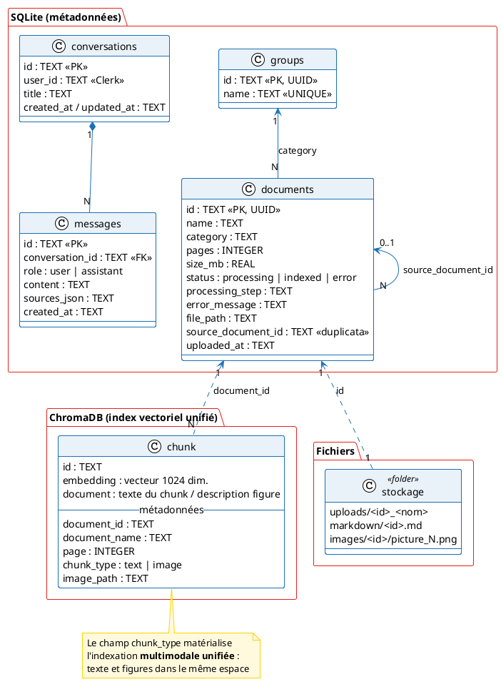

# Guide de génération des visuels du rapport

Ce fichier recense **10 visuels** référencés dans `docs/rapport/main.tex`. Chaque figure
doit être déposée dans `docs/images/` sous le nom de fichier indiqué. Tant qu'un fichier
est absent, le rapport compile quand même (un cadre placeholder s'affiche à sa place) ;
dès que le fichier est déposé, une recompilation (`pdflatex` ×2) l'intègre.

- **Images standard** → prompt à copier-coller dans un générateur d'images. Tous les
  prompts imposent la palette ALTEN : **fond blanc dominant, accents bleu #1B6FB5,
  rouge #E2231A et jaune/or #FFD400**, texte noir/gris foncé.
- **Diagrammes UML** → code PlantUML complet, à compiler en PNG/SVG
  (`plantuml -tpng fichier.puml` ou https://www.plantuml.com/plantuml). Un thème couleur
  ALTEN est inclus dans chaque bloc.

> Astuce : si vous générez des SVG, convertissez-les en PNG avant inclusion (le rapport
> référence des `.png`), ou adaptez l'extension dans le `.tex`.

---

## 1. `docs/images/rag_principe.png` — Principe général du RAG *(image standard)*

**Prompt :**

> Clean technical illustration of the Retrieval-Augmented Generation (RAG) paradigm, on a
> pure white background, in a flat modern corporate infographic style. Two horizontal
> stages: (1) top row labeled "Indexation (hors ligne)": documents icon → "Découpage en
> chunks" → "Modèle d'embeddings" → a vector database cylinder labeled "Base vectorielle";
> (2) bottom row labeled "Question (en ligne)": a user icon with a speech bubble
> "Question" → "Embedding de la question" → arrow into the same vector database → "Top-k
> passages pertinents" → a large language model chip icon labeled "LLM" → a document-style
> answer card labeled "Réponse sourcée [Source 1] [Source 2]". Use a strict color palette
> inspired by the ALTEN logo: dominant white background, medium blue #1B6FB5 for main
> boxes and arrows, red #E2231A for one or two key highlights (the LLM chip and the final
> answer border), yellow-gold #FFD400 for small accent markers, black/dark-gray text.
> Thin lines, rounded rectangles, subtle shadows, French labels, no photorealism, no dark
> background, 16:9 aspect ratio.

---

## 2. `docs/images/rag_multimodal_approches.png` — Trois approches d'indexation des images *(image standard)*

**Prompt :**

> Flat modern comparison infographic on a pure white background showing three side-by-side
> vertical panels, each describing a strategy to make document images searchable. Panel 1
> titled "OCR seul": an image/diagram icon → an OCR scanner icon → a small text snippet
> icon, caption "Texte visible uniquement". Panel 2 titled "Description par VLM"
> (visually emphasized as the chosen approach, with a red #E2231A "retenu" ribbon or
> border): an image icon → a vision-language model chip icon labeled "VLM" → a paragraph
> icon labeled "Description détaillée" → a vector database cylinder shared with text
> chunks, caption "Index unifié texte + images". Panel 3 titled "Embeddings multimodaux":
> image and text icons both projected into a shared 2D dot-cloud/vector-space
> illustration, caption "Espace commun (CLIP / ColPali)". Strict ALTEN-inspired palette:
> dominant white, medium blue #1B6FB5 for boxes/icons/arrows, red #E2231A only to
> highlight the chosen panel, yellow-gold #FFD400 for small accents, dark-gray text.
> Clean thin-line corporate style, French labels, light theme only, 16:9.

---

## 3. `docs/images/pipeline_global.png` — Pipeline fonctionnel complet *(diagramme PlantUML — activité)*

---

## 4. `docs/images/architecture_globale.png` — Architecture globale *(image standard)*

**Prompt :**

> Professional software architecture diagram, flat corporate style, pure white
> background. Three horizontal tiers connected by thin blue arrows. Top tier "Frontend —
> React 18 + TypeScript (Vite)": browser window icon containing three module cards
> "Documents", "Chat", "Auth (Clerk)". Middle tier "Backend — FastAPI (Python)": a large
> rounded rectangle containing cards "API REST (/api/documents, /api/groups, /api/chat)",
> "File d'ingestion (worker unique)", "Recherche hybride (dense + BM25 + RRF)",
> "Fichiers statiques /static/images". Bottom tier "Persistance": cylinders "SQLite",
> "ChromaDB", a folder icon "Fichiers (uploads, markdown, images)", and a small cache
> icon "Redis / FakeRedis". On the right side, a vertical column of external cloud
> services connected to the backend with dashed blue lines: "Mistral AI (embeddings +
> LLM)", "HF Inference / DeepInfra (VLM Gemma-3 27B)", "Clerk (JWKS)", "Groq (juge
> RAGAS)". Strict ALTEN-inspired palette: dominant white, medium blue #1B6FB5 for
> borders/arrows/headers, red #E2231A sparingly for the backend tier title bar, yellow-gold
> #FFD400 for small accent chips, dark-gray text. Clean thin lines, rounded corners,
> French labels, light theme only, 16:10.

---

## 5. `docs/images/uml_paquetages_backend.png` — Paquetages du backend *(diagramme PlantUML — composants/paquetages)*

---

## 6. `docs/images/uml_sequence_ingestion.png` — Séquence d'ingestion *(diagramme PlantUML — séquence)*

---

## 7. `docs/images/uml_sequence_chat.png` — Séquence question–réponse *(diagramme PlantUML — séquence)*

---

## 8. `docs/images/uml_cas_utilisation.png` — Cas d'utilisation *(diagramme PlantUML — cas d'utilisation)*

---

## 9. `docs/images/uml_modele_donnees.png` — Modèle de données *(diagramme PlantUML — classes)*

---

## 10. `docs/images/ragas_radar.png` — Synthèse RAGAS *(image standard)*

**Prompt :**

> Minimal clean data visualization on a pure white background: a radar/spider chart with
> exactly four axes labeled in French "Faithfulness (0,83)", "Answer Relevancy (0,93)",
> "Context Precision (0,84)", "Context Recall (1,00)", scale from 0 to 1 with light gray
> grid rings at 0.25/0.5/0.75/1.0. The data polygon is filled with a translucent medium
> blue #1B6FB5 (about 25% opacity) with a solid blue outline and small red #E2231A dots
> at each vertex; one small yellow-gold #FFD400 badge near the "Context Recall" vertex
> highlighting the perfect score "1,00". Title above the chart in dark gray: "Évaluation
> RAGAS — moyennes sur 6 questions". Flat corporate infographic style inspired by the
> ALTEN color palette (white dominant, blue/red/gold accents), no dark background, no 3D,
> square aspect ratio.

*(Alternative : ce graphe peut aussi être tracé précisément avec matplotlib à partir des
moyennes du tableau RAGAS du chapitre 3.)*

---

## 11–12. Captures d'écran de l'application *(recommandé : vraies captures)*

Pour `docs/images/ui_chat.png` et `docs/images/ui_documents.png`, le mieux est une **vraie
capture d'écran** de l'application en thème clair (lancer l'app, cf. `HOW_TO_RUN.md`).
À défaut, prompts de génération :

**`ui_chat.png` :**

> High-fidelity UI mockup of a modern document-assistant chat interface, light theme,
> white background. Left sidebar with a conversations list. Main area: a user question
> bubble "Montre-moi l'architecture du Transformer", followed by an assistant answer card
> in clean typography citing sources inline as "[Source 1]" chips, below it a row of
> source cards (document name "Attention Is All You Need.pdf", page number) and a
> displayed technical figure of a neural network architecture diagram. Bottom: a rounded
> message input with a document-scope selector chip "Périmètre : automatique". Accent
> colors from the ALTEN palette: medium blue #1B6FB5 for primary buttons and links, a
> touch of red #E2231A on the send button, yellow-gold #FFD400 on one small badge; white
> dominant, dark-gray text, subtle gray borders, French interface labels, 16:10.

**`ui_documents.png` :**

> High-fidelity UI mockup of a document-management view in a modern web app, light theme,
> white background. Header "Documents" with an upload dropzone ("Glissez vos PDF, Word,
> Excel ici"). A grid of document cards, each with a file icon, title (e.g. "BERT.pdf",
> "Circuit Diagram Symbols.pdf"), a group badge ("Research Paper", "Technical Manual"),
> page count, and a status chip: most green "Indexé", one blue animated "Décrit la figure
> 3/5...", one red "Erreur". A left sidebar lists document groups with counts. Accent
> colors from the ALTEN palette: medium blue #1B6FB5 for primary elements, red #E2231A
> only on the error chip, yellow-gold #FFD400 on one highlight badge; dominant white,
> dark-gray text, subtle shadows, French labels, 16:10.

---

## Récapitulatif des fichiers attendus dans `docs/images/`

| # | Fichier | Type | Source |
|---|---------|------|--------|
| 1 | `rag_principe.png` | Image | Prompt §1 |
| 2 | `rag_multimodal_approches.png` | Image | Prompt §2 |
| 3 | `pipeline_global.png` | UML (activité) | PlantUML §3 |
| 4 | `architecture_globale.png` | Image | Prompt §4 |
| 5 | `uml_paquetages_backend.png` | UML (paquetages) | PlantUML §5 |
| 6 | `uml_sequence_ingestion.png` | UML (séquence) | PlantUML §6 |
| 7 | `uml_sequence_chat.png` | UML (séquence) | PlantUML §7 |
| 8 | `uml_cas_utilisation.png` | UML (cas d'utilisation) | PlantUML §8 |
| 9 | `uml_modele_donnees.png` | UML (classes) | PlantUML §9 |
| 10 | `ragas_radar.png` | Image (graphique) | Prompt §10 |
| 11 | `ui_chat.png` | Capture d'écran (ou prompt §11) | App réelle |
| 12 | `ui_documents.png` | Capture d'écran (ou prompt §12) | App réelle |

Déjà présents : `alten.png` et `ensam.png` (logos, page de garde).
